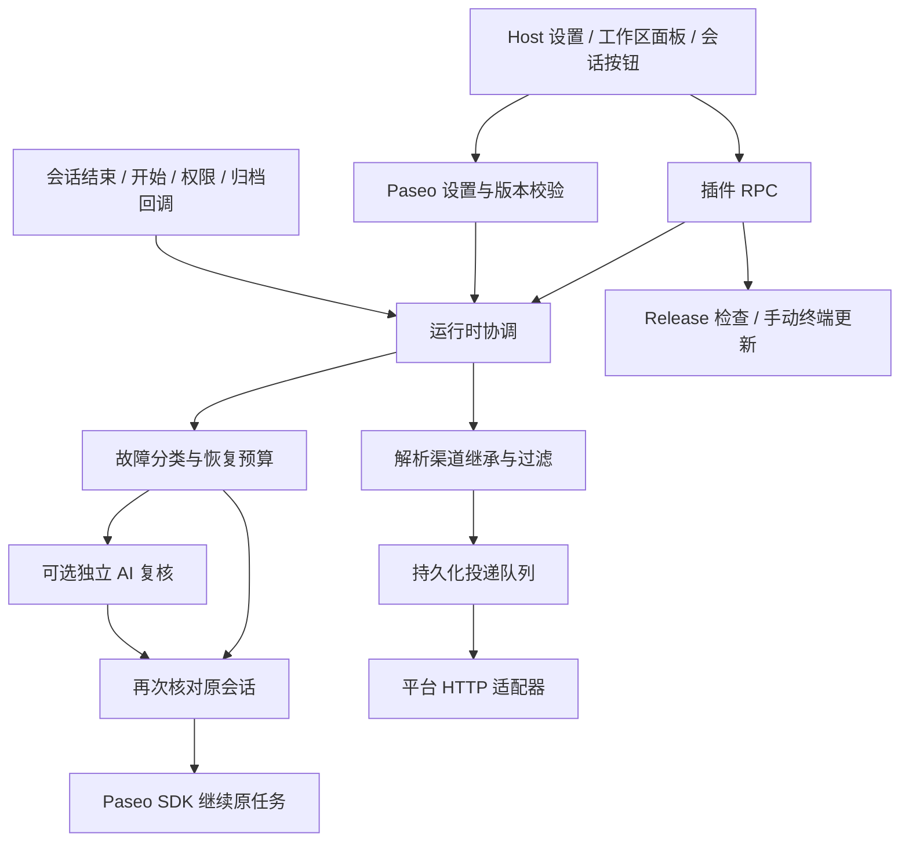

# 架构

插件分为客户端、共享协议和宿主侧服务。客户端是 Paseo 原生插件界面；服务端通过宿主事件回调工作。没有 MCP 服务、额外 HTTP 管理端口或轮询会话列表的后台任务。

## 代码职责

| 位置                                            | 职责                                                     |
| ----------------------------------------------- | -------------------------------------------------------- |
| `index.client.tsx`、`client/`                   | 注册设置页、工作区面板、会话按钮和恢复卡片；管理编辑草稿 |
| `shared/`                                       | Zod 配置和 RPC 契约、路由、导入导出、版本常量            |
| `index.server.ts`                               | 注册生命周期回调、设置订阅与 RPC，负责启动和清理         |
| `server/runtime.ts`                             | 协调恢复状态、任务预算、通知入队和发送调度               |
| `server/classifier.ts`、`policy.ts`             | 故障类别、退避、是否允许继续                             |
| `server/reviewer.ts`、`paseo.ts`、`timeline.ts` | 独立复核、执行状态检查与事件内容提取                     |
| `server/channels.ts`                            | 平台格式、签名、请求限制与回执判断                       |
| `server/storage.ts`                             | 私有文件、写入串行化、原子替换、实例锁                   |
| `server/schedules.ts`                           | 只读任务元数据与稳定任务 ID 解析                         |
| `server/transfer.ts`                            | 可移植配置合并与私有凭据暂存                             |
| `server/updates.ts`、`update-runner.ts`         | 公共 Release 缓存、来源校验与宿主终端安装                |

## 一次中断如何处理

收到 `agent.turn_ended` 后，先判断当前执行结果。临时故障进入已有预算下的恢复计划；不允许恢复的结果按路由发送通知。恢复到期时重新检查原任务，必要时启动独立复核，再记录发送意图并提交继续指令。新的执行事件会使旧等待计划失效；新执行再次失败时重新判断。检查不依赖聊天内容或历史长度，正常完成、正在运行及权限等待会阻止额外续跑。

正常完成、恢复后完成、最终失败与权限等待进入投递队列。各渠道独立串行发送；平台失败不会重新运行原 AI 任务。界面读取运行状态使用短期刷新，后台不依赖界面保持打开。

## 配置与秘密的边界

普通设置由 Paseo 管理并带 revision；保存时做并发校验。客户端先保存渠道定义，再通过独立 RPC 发送凭据。后端 RPC 等待设置订阅应用完成，避免“保存成功”后渠道尚不可见。

客户端草稿只在组件内存中保留；私有凭据和运行记录分别存在 Host 目录。详细边界见[存储与可靠性](Storage-and-reliability.md)。

更新检查独立于通知调度；安装通过公开终端 SDK 启动官方 CLI，没有引用 Paseo 私有客户端接口，也不自行替换正在执行的源码。

恢复策略由 `shared/recovery.ts` 统一解析，使用 Session → Workspace → Host 的完整配置覆盖。创建重试计划、预算检查、继续指令、AI 复核和重启恢复均读取有效策略。配置更新只使有效策略发生变化的会话作废其进行中的检查；本地范围覆盖仍存放于 Host 设置，不新增会话数据库。
