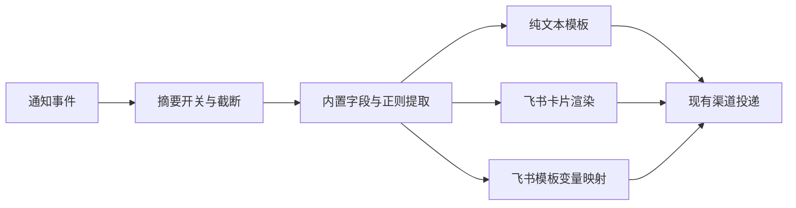

# 飞书卡片扩展方案

这是后续设计，尚未实现。当前飞书 / Lark 渠道仍发送纯文本；已实现的设置见[飞书渠道](Channel-Feishu.md)。

## 接入方式

飞书自定义群机器人的现有 Webhook 可以发送消息卡片，消息类型为 `interactive`，仍使用原有 Webhook 和可选签名密钥。卡片模板需在飞书搭建工具中发布，并授权目标机器人使用。自定义机器人发送的卡片支持静态展示和链接跳转；向服务端提交数据的卡片交互需要应用机器人。依据：[飞书官方卡片发送指南](https://open.feishu.cn/document/feishu-cards/quick-start/send-message-cards-with-custom-bot)。

因此，首先扩展发送内容即可，沿用现有通知路由、签名、投递队列和平台回执判断。渲染本身无状态，不需要新增会话数据库或保存整段聊天记录。

## 配置入口

建议在每个飞书渠道的编辑页增加「消息格式」选择，其他平台继续使用已有文本模板。

| 格式     | 用户配置                       | 适用场景                     |
| -------- | ------------------------------ | ---------------------------- |
| 纯文本   | 沿用「通知管理」的标题、正文   | 现有行为与迁移默认值         |
| 内置卡片 | 标题、正文、信息字段、可选链接 | 无需维护卡片 JSON 的常用通知 |
| 飞书模板 | 模板 ID、发布版本、变量映射    | 在飞书搭建工具中自行设计样式 |

建议先提供内置卡片，再加入飞书模板。模板版应固定发布版本，使展示变化可控；由用户把飞书变量名映射到 `{{title}}`、`{{summary}}`、`{{custom.ticket}}` 等现有字段。模板 ID、版本和映射属于可导入导出的普通渠道配置，Webhook 与签名密钥继续保存在凭据中。

Host → Workspace → Session 的继承只决定发送到哪些渠道。消息格式跟随渠道，定时任务也可选择同一个卡片渠道，无需改变继承规则。

## 内置卡片内容

默认卡片包含事件标题、会话标题、状态说明、提供方、时间及有值的恢复信息，按完成、失败、待处理等事件选择标题颜色。回复摘要及其提取结果继续遵守现有摘要开关和长度限制；关闭摘要时不从完整会话补取数据。

「打开会话」按钮需要能被接收者访问的 Paseo 地址或有效深链。目前只有会话 ID，不能据此直接假定访问地址；未配置可用地址时隐藏按钮。来自 Pattern 的结果链接也需校验为允许的 URL，再放入跳转字段。

## 代码边界

实施时把 `shared/templates.ts` 中的字段收集和正则提取拆成可复用的上下文生成函数，文本及卡片渲染器共用结果。平台发送层负责格式封装、签名和回执，避免在每个渠道重复解析 Pattern。

内置卡片用 TypeScript 构建对象，最后统一序列化 JSON。占位符仅填入允许的文本或链接字段，不对整段 JSON 做字符串替换；正文中的引号、换行、花括号都作为数据处理。文本、Markdown、URL 分别校验和处理，保持现有避免意外提及群成员的行为。

界面预览与实际发送使用同一个渲染结果。内置卡片可在原生设置页预览主要内容；飞书模板的具体样式由飞书搭建工具预览，本插件显示最终变量值。平台的确定性参数错误应显示可修正的失败原因，超时后不自动改发一条文本，以免回执不确定时重复通知。

## 后续交互

若要支持「继续任务」「批准操作」或输入回复，需要另外设计应用机器人身份、回调接收、操作者权限、事件去重和会话绑定；不能把链接跳转按钮直接当作执行任务的入口。这部分属于回复与控制能力，不包含在发送卡片的第一步中。

相关：[消息模板与 Pattern](Message-templates.md) · [通知去向与继承](Notification-routing.md) · [架构](Architecture.md)
