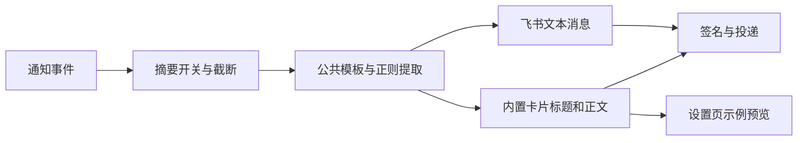

# 飞书卡片与后续扩展

从 v0.4.0 起，每个飞书 / Lark 渠道可以选择文本消息或内置卡片。使用步骤与示例见[飞书渠道](Channel-Feishu.md)。本页说明实现边界和后续扩展方向。

## 已实现：内置通知卡片

卡片直接通过现有群机器人 Webhook 发送，使用 `msg_type: interactive`，复用签名、投递队列及平台业务回执判断。它采用飞书经典卡片的标题栏和 `div` / `plain_text` 内容组件，不需要额外创建飞书模板。依据：[自定义机器人说明](https://open.feishu.cn/document/client-docs/bot-v3/add-custom-bot)、[飞书卡片发送指南](https://open.feishu.cn/document/feishu-cards/send-feishu-card)。

普通配置中的 `channels[].feishu.messageType` 为 `text` 或 `card`，未填写时按文本处理。Webhook 和密钥仍单独存放在凭据中，切换格式不修改凭据。Host → Workspace → Session 继承及定时任务绑定只选择渠道；卡片格式随渠道生效。

`shared/templates.ts` 统一生成标题和正文；`shared/feishu.ts` 将结果放入卡片，并按事件选择标题栏颜色。界面与发送端使用同一个卡片构建函数。渲染无状态，不新增会话数据库，不保存整段聊天记录。

卡片使用对象构建后序列化，避免对 JSON 字符串直接替换。标题和正文是普通文字，不解释任务提供的 Markdown 或提及语法。截断按 JSON 转义后的 UTF-8 字节计算：标题最多 1000 字节、正文最多 12000 字节，留出结构和签名空间，使完整请求低于 20 KB。文本消息也使用转义后的字节预算。

设置页预览使用模板草稿；实际投递与「发送测试」使用已保存的渠道设置。平台失败沿用现有错误处理和重试策略，超时不会改发另一条文本通知。

## 后续：飞书自定义模板

尚未实现。计划在「卡片消息」下面增加「卡片样式：内置通知卡片 / 飞书自定义模板」，选择自定义模板后才显示模板 ID、发布版本及变量映射。例如飞书变量 `ticket` 对应 `{{custom.ticket}}`。自定义模板需要在飞书搭建工具中发布，并授权目标机器人使用；这些要求不适用于当前内置卡片。

模板应固定发布版本，避免远端样式变更造成意外。变量映射属于可导入导出的普通配置，摘要变量仍遵守隐私开关。届时可把公共模板的字段收集进一步抽成上下文函数，供多个卡片变量复用。

## 后续：链接和交互

当前卡片没有「打开会话」「继续任务」或回复按钮。会话跳转需要可访问的 Paseo 地址或有效深链，不能仅根据会话 ID 猜测地址。提取出的 URL 也需要校验后才能作为按钮目标。

自定义机器人卡片支持静态展示与链接跳转，不支持向服务端提交数据的回调交互，见[官方指南](https://open.feishu.cn/document/feishu-cards/quick-start/send-message-cards-with-custom-bot)。回复或执行操作需要另行设计应用机器人身份、回调接收、操作者权限、事件去重及会话绑定。

相关：[消息模板与 Pattern](Message-templates.md) · [通知去向与继承](Notification-routing.md) · [架构](Architecture.md)
